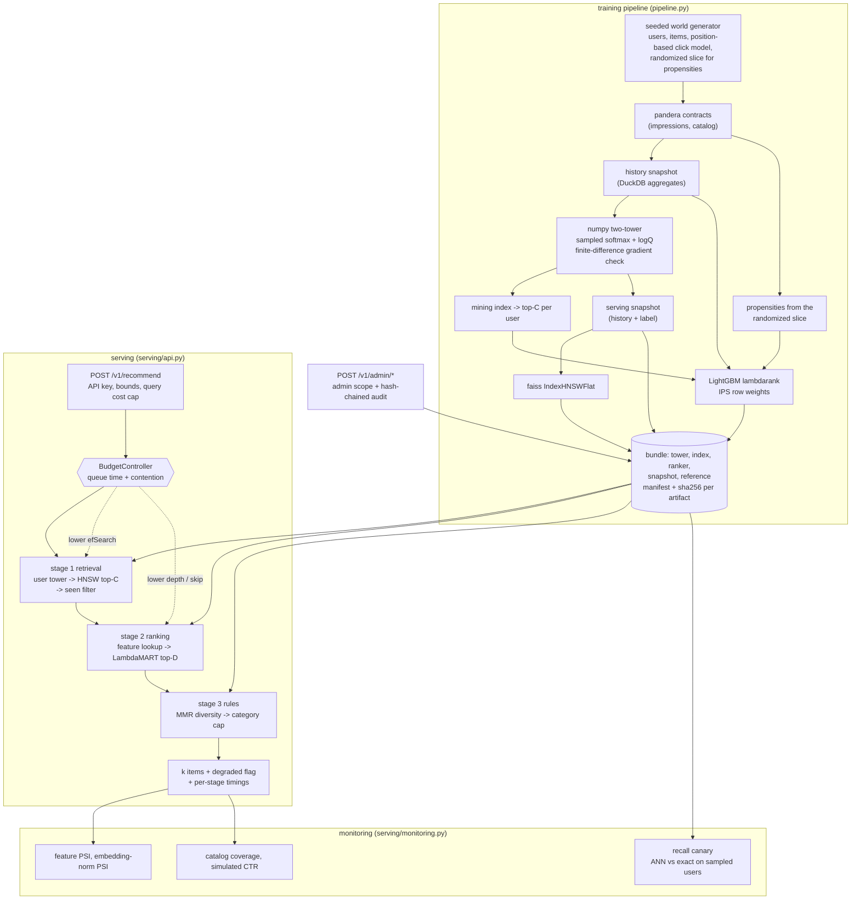

# retrieval-ranking-cascade

A recommender that picks twenty items for one person out of a catalogue of thousands, answers in
about 13 milliseconds, and keeps working when the machine is overloaded, when the search index
quietly rots, and when the click data it learns from is systematically misleading.

## The problem

Picture the "recommended for you" row on a shop or a streaming service. Filling it is a search over
the entire catalogue, and it has to finish before the page renders.

One model cannot do that. A model precise enough to order the final twenty items is far too
expensive to run over 100,000 of them; a model cheap enough to run over 100,000 is not precise
enough to order twenty. So the work is split into stages: a cheap stage narrows the catalogue to a
few hundred plausible candidates in a fraction of a millisecond, and an expensive stage ranks only
those.

That split buys the latency and creates three failures a working demo will never show you. Each one
is silent, which is what makes it expensive.

**The cheap stage can throw away the right answer.** Narrowing thousands of items to 500 uses
approximate search, which trades exactness for speed. It always returns 500 plausible-looking items:
after a bad index rebuild, after a mistyped tuning parameter, after half the vectors are overwritten.
Nothing raises an error. Recommendations simply get worse, revenue drifts down, and there is no stack
trace to follow. This repo runs a background check that compares the approximate search against a
slow exact search on real users, and alerts when they disagree.

**Overload turns a latency problem into an outage.** The usual answer to "this request will not make
the deadline" is a timeout: the user waits the whole budget and gets nothing, the server burns the
CPU anyway, and under load every request pays full cost and then fails. For a recommendation that is
the wrong trade, because a slightly rougher list is obviously better than an error page. This service
predicts, before each stage, whether the planned work fits in the time left, and when it does not it
does less work and says so in the response.

**The training data lies in a measurable way.** People click the top of a list far more than the
bottom, whatever is in it, so a click measures attention times quality rather than quality. Anything
trained or scored on raw clicks learns the previous ranking's habits and calls it relevance. Ship a
model on that evidence and you ship a worse recommender while the dashboard reports an improvement.
This repo estimates how much of each position's click rate is attention, divides it back out, and
reports the corrected and uncorrected numbers side by side.

Everything runs offline on a CPU-only machine. The data comes from a seeded generator, so ground
truth is known and the bias correction can be graded against it. Training takes about 13 seconds.
There is no API key, no GPU and no downloaded model.

## What this does

- **Serves a recommendation in three stages under one 50 ms deadline.** Stage 1 narrows the catalogue
  to 500 candidates, stage 2 ranks the best 100 of them precisely, stage 3 applies business rules:
  variety, and a hard cap on how many items from one category may appear.
- **Sheds quality instead of failing when it runs out of time.** Under pressure it searches less
  carefully, then ranks fewer candidates, then returns the cheap stage's order — and marks the
  response `degraded` so the caller and the dashboard can tell the difference. At four times the
  nominal load it still answered every request, with zero errors.
- **Checks its own accuracy in the background.** A canary (a cheap recurring self-test) compares the
  fast approximate search with an exact search over sampled real users. Corrupt half the index and it
  alerts on the next cycle, 0.09 seconds later.
- **Corrects the position bias in click data**, both when training the ranker and when reporting
  results. Because this world is synthetic, the correction can be graded against the truth: it
  removes 85% of the error.
- **Ships the model as one verified unit.** The embedding model, the search index, the ranker, the
  feature snapshot and the drift reference travel together with a manifest and a SHA-256 per file. A
  deployment cannot silently pair a new index with an old ranker, and no file is parsed before its
  hash is checked. Nothing is pickled.

## Architecture



### How one request flows

1. **The door.** `POST /v1/recommend` arrives with an API key, compared against stored SHA-256
   digests in constant time. Every knob a caller may set (`k`, `candidate_k`, `ef_search`, the
   diversity weight) is bounded, and a cost cap rejects combinations that are individually legal but
   expensive together.
2. **The clock starts.** The budget controller takes the 50 ms request budget, subtracts the time the
   request already spent waiting in the queue, and scales its cost estimates by how many requests are
   in flight. Planning the whole request costs 6 microseconds, about 0.01% of the budget it protects.
3. **Stage 1, narrowing (about 1.1 ms).** The user tower turns the user's history into 32 numbers.
   The HNSW index — a navigable graph over item vectors, searched approximately — returns the 500
   nearest items. Items the user already clicked are dropped here, before the expensive stage, so
   nothing pays to score an item that was going to be thrown away.
4. **Stage 2, ranking (about 2 ms).** The top 100 candidates each get ten features (user-history
   aggregates, item statistics, tower similarity, recency), and a LightGBM LambdaMART model — a
   gradient-boosted tree ensemble trained to order lists — scores them.
5. **Stage 3, rules (about 0.8 ms).** MMR reorders for variety, trading a little relevance for a less
   repetitive page, and a hard per-category cap trims what is left. The cap may return a short page
   rather than break the constraint.
6. **The answer.** The response carries the items, the time each stage took, the bundle id that
   produced them, and `degraded` plus its reasons when the ladder was used. At the nominal rate the
   server's own view of all of this is 4.2 ms.
7. **Afterwards.** The recall canary, feature drift (PSI), catalogue coverage and a simulated
   click-through rate run outside the request path and are exported as Prometheus metrics.

When step 2 predicts the plan does not fit, the controller walks a ladder, cheapest loss of quality
first: lower `efSearch` (search less carefully), then lower the rerank depth (score fewer
candidates), then skip stage 2 and return the retrieval order, flagged `degraded`. A stage that has
already started is never interrupted — the controller bounds *planned* work only.

## Results

Every number below comes from a real run on one machine: **Windows 10 (10.0.19045), Intel64 Family 6
Model 158 Stepping 10, 6 logical CPUs, CPU-only, Python 3.12.14**, on 2026-09-27, at the `small`
scale (5,000 users, 10,000 items, about 200,000 impressions). Each block names the command that
produced it, and the raw output is committed under `bench/results/`. CI runs the same commands
against the thresholds in `bench/thresholds.json`.

### Serving latency

`uv run python tasks.py load`, which runs `bench/bench_load.py --check`: the repo's own `serve` entry
point in a separate process, one uvicorn worker, one faiss thread, and three client processes issuing
requests on a fixed schedule (an open loop, so a slow response queues behind rather than delaying the
next send). `candidate_k` 500, `efSearch` 768, rerank depth 100, k=20, 50 ms budget. The run printed
"load thresholds met" and is recorded in `bench/results/load.json`.

| phase | target RPS | achieved | p50 ms | p95 ms | p99 ms | server p50 ms | errors | degraded | peak in-flight |
|---|---:|---:|---:|---:|---:|---:|---:|---:|---:|
| nominal | 50 | 50.1 | 12.74 | 16.67 | **20.51** | 4.23 | 0 | 0.0% | 3 |
| overload 2x | 100 | 100.0 | 16.99 | 26.26 | 36.09 | 5.23 | 0 | 0.0% | 6 |
| saturate 4x | 200 | 200.0 | 28.59 | 88.42 | 124.72 | 8.70 | 0 | 0.1% | 18 |

What those numbers mean, plainly:

- **p50 of 12.74 ms** — half of all requests were answered faster than that.
- **p99 of 20.51 ms** — the slowest 1 request in 100 still answered in 20.5 ms, well inside the
  50 ms promise, with no request failing.
- **0.0% degraded at the nominal rate** — the service never needed to cut quality to make the
  deadline. At four times the load it cut quality on 0.1% of requests and still answered all of them.
- **server p50 4.23 ms against a client-observed 12.74 ms** — most of what a client sees at low load
  is connection handling and the client's own event loop, not the cascade.

Latency numbers move with whatever else the machine is doing. Three clean runs measured a nominal p99
of 18.1, 20.5 and 26.8 ms; runs taken while the test suite was also running measured 39.7 and 48.7 ms
(`MODEL_CARD.md`). That is the shape of a shared box, not of the code, which is why CI enforces a
machine-independent invariant instead of an absolute limit: **whenever throughput falls behind the
offered rate, at least 10% of responses must be degraded** (`min_degraded_rate_when_behind` in
`bench/thresholds.json`). Falling behind while still planning full work is precisely the failure this
design exists to prevent. Errors must be zero in every phase, and throughput must hold at the nominal
rate.

The 4x phase is also where the measurement itself gets hard, and the bench says so out loud. Three
client processes on six cores are close to their own ceiling there, and when a client's connection
pool becomes the queue, client-observed latency runs far above the server's own view of the same
requests. The bench compares the two at the median *and* at the 99th percentile — a pool saturates at
the tail first — flags such a phase `harness-limited`, and declines to assert the shed-quality
invariant for it, because the budget controller correctly saw nothing late to shed. The ladder itself
is therefore tested directly rather than only through load: `tests/unit/test_budget.py` and
`tests/unit/test_cascade.py` drive each of its three steps with starved budgets and with contention,
and `tests/integration/test_cascade_api.py::test_a_degraded_response_is_labelled_and_counted` checks
the flag and the counter over HTTP.

### Retrieval: how much the fast search misses

`uv run python bench/bench_quality.py --check --ablations` — one training run of 13.4 s feeding every
block, 124.7 s in total, printed "all quality thresholds met", recorded in
`bench/results/quality.json`. Recall@500 is measured against exact search over 200 queries:
**of the 500 items an exhaustive search would have returned, what share did the fast search find?**

| efSearch | recall@500 | recall p05 | ANN ms/query |
|---:|---:|---:|---:|
| 64 | 0.6232 | 0.4997 | 0.126 |
| 128 | 0.8057 | 0.6457 | 0.204 |
| 256 | 0.9313 | 0.7659 | 0.364 |
| 512 | 0.9757 | 0.9340 | 0.616 |
| **768 (default)** | **0.9771** | **0.9360** | **1.099** |
| 1024 | 0.9774 | 0.9360 | 1.775 |

At the default the fast search finds **97.7%** of what exact search would have found, and even the
unluckiest 5% of users (the `recall p05` column) still get 93.6%. `efSearch` is how hard the graph
looks before giving up; more of it costs time and buys recall, which is exactly what makes it the
first rung of the degradation ladder.

### Does the index earn its place?

Not at this catalogue size, and the bench answers with numbers instead of a caveat. Exact brute force
over the same 200 queries costs 0.136 ms/query, so at 10,000 items the graph walk is about **8x
slower** than one dense 10,000 x 32 matrix multiply.

Since the `small` world is the only world this repo trains, the scaling block measures the cost curve
on larger catalogues directly. Rows past the trained 10,000 are real item embeddings resampled with
Gaussian noise and rescaled to the norm of the row they came from, which preserves the cluster
structure the graph walks over. Search cost and recall against exact search *on the same catalogue*
are real measurements of the index at that size; relevance on those rows would not be, and nothing
uses them for it.

| catalogue size | resampled rows | ANN ms/query | exact ms/query | ANN speedup | recall@500 |
|---:|---:|---:|---:|---:|---:|
| 2,500 | 0 | 1.015 | 0.073 | 0.07x | 0.9756 |
| 10,000 (as trained) | 0 | 1.137 | 0.135 | 0.12x | 0.9771 |
| 50,000 | 40,000 | 1.237 | 0.518 | 0.42x | 0.9980 |
| 100,000 | 90,000 | 1.362 | 0.866 | 0.64x | 0.9964 |

Fitted over those four points, exact search costs 0.0082 ms per 1,000 items while the graph costs
1.06 ms fixed plus 0.0032 ms per 1,000, so **the two lines meet near 197,000 items**. Two sizes could
not have settled this (across runs a two-point fit produced both signs of slope for the exact
baseline); four can.

What the index does pay for is a *small* request. `efSearch` must be at least the number of
neighbours asked for, so the graph's cost grows with the request while the matrix multiply's does
not. At 100,000 items:

| candidates | efSearch | ANN ms/query | exact ms/query | ANN speedup | recall |
|---:|---:|---:|---:|---:|---:|
| 10 | 64 | 0.055 | 0.850 | **15.5x** | 0.9940 |
| 50 | 128 | 0.109 | 0.899 | 8.3x | 0.9942 |
| 100 | 256 | 0.272 | 0.981 | 3.6x | 0.9973 |
| **500 (this cascade)** | **768** | **1.393** | **0.855** | **0.61x** | 0.9964 |

So a 32-dimensional index over 100,000 items beats brute force by 15x when a request wants ten
neighbours and loses to it when the request wants five hundred — and this cascade wants five hundred,
because stage 2 needs a candidate *set*, not a page. The index stays because it is what makes the
recall/latency knob and the recall canary mean anything, and because it is the structure a larger
catalogue would need. It is not here because it is faster at the size measured.

### Ranking quality

Two protocols, because they answer different questions.

**Reordering a real slate** (1,500 held-out sessions, k=10). Each policy reorders exactly the items
the logging policy showed, scored three ways: naively from clicks, with IPS weights, and against the
world's true relevance.

| policy | NDCG naive | NDCG IPS | NDCG truth | MRR naive | MRR truth |
|---|---:|---:|---:|---:|---:|
| logged (the policy that produced the data) | 0.8257 | 0.7083 | 0.8629 | 0.8140 | 0.5308 |
| **cascade** | 0.6909 | 0.6176 | **0.8545** | 0.6245 | 0.5010 |
| tower only | 0.6643 | 0.5993 | 0.8324 | 0.5852 | 0.4548 |
| popularity | 0.6231 | 0.5530 | 0.7442 | 0.5211 | 0.3061 |

NDCG@10 rewards putting relevant items near the top of a ten-item list; 1.0 is a perfect order. On
ground truth the cascade beats both baselines (+0.022 over the tower, +0.110 over popularity). It
does not beat the logged policy and should not be expected to: this world's logging policy scores
candidates with a noisy version of the true relevance logit, so it is a strong teacher rather than a
straw man. Note what the naive column does — it ranks the logged policy far ahead, while ground truth
puts it barely ahead. That gap is the position bias this repo exists to measure.

**Ranking the whole catalogue** (top-10 scored against true relevance). Every row is averaged over
the same 150 sampled users, the unservable `exact_rank` row included, and each row carries its own
count, because an earlier version of this table computed that row over 40 users under a header that
claimed 150 for all of them, which made an unpaired comparison look paired.

| policy | users | NDCG@10 | intra-list sim | coverage | cold-item share | cold-user NDCG (users) |
|---|---:|---:|---:|---:|---:|---:|
| popularity | 150 | 0.3224 | 0.5429 | 0.0015 | 0.0000 | 0.2733 (19) |
| tower only | 150 | 0.6205 | 0.6276 | 0.0488 | 0.0440 | 0.4584 (19) |
| cascade (MMR off) | 150 | 0.6100 | 0.5128 | 0.0228 | 0.0661 | 0.4125 (19) |
| cascade (as served) | 150 | 0.6059 | 0.5062 | 0.0226 | 0.0648 | 0.4115 (19) |
| exact full-corpus ranking | 150 | 0.6095 | 0.4828 | 0.0446 | 0.1513 | 0.3708 (19) |

**The candidate set costs nothing.** Scoring all 10,000 items with the same LambdaMART model gets
0.6095 against the cascade's 0.6100 over the same 150 users — a gap of -0.0004, so the cascade
retains **1.0007** of an exact full-catalogue ranking while scoring 100 candidates instead of 10,000.
Neither of its two approximations, a finite candidate set and an approximate search inside it, costs
measurable quality here. `exact_rank` is a reference, not a ceiling: the same imperfect model scoring
more items can land slightly *below* it on true relevance, and here it does. It is also a raw top-k
by model score with no MMR and no category cap, which is why its coverage and cold-item share are the
highest in the table and its cold-user NDCG the lowest.

**The reranker still does not beat the tower on this protocol** (0.6100 against 0.6205). Because the
full-corpus ranking with the same model does not beat the tower either, the limit is the model rather
than the cascade around it: the ranker is trained on label-period slates the logging policy chose,
which is the only supervision click data can honestly provide, and that distribution does not cover
the full catalogue. It wins on the slate protocol, where it was trained, and comes 0.0105 short on
the corpus protocol. Reported rather than smoothed over; closing it needs candidate-aware negative
mining, which is a non-goal below.

MMR and the category cap then cost 0.0041 NDCG and buy lower intra-list similarity (0.5062 against
0.5128) and a higher share of cold items — a less repetitive page, at a price that is now measured
rather than assumed.

### Correcting the position bias

Mean relevance per rank over non-randomized impressions. The question is how close each estimate gets
to the truth in the right-hand column.

| rank | naive CTR | IPS estimate | true relevance |
|---:|---:|---:|---:|
| 1 | 0.6008 | 0.6008 | 0.6023 |
| 2 | 0.2415 | 0.4897 | 0.4931 |
| 5 | 0.0748 | 0.3287 | 0.3772 |
| 10 | 0.0273 | 0.3154 | 0.2783 |

Read row 10: judged by raw clicks, an item shown tenth looks 22x less relevant than one shown first
(0.0273 against 0.6008). In truth it is about half as relevant (0.2783 against 0.6023). Almost all of
that apparent collapse is attention, not quality — and a ranker trained on the naive column spends
its capacity reproducing it.

Mean absolute error against truth: **naive 0.2513, IPS 0.0373 — an 85.2% reduction.** The examination
exponent recovered from the randomized slice alone is 1.024 against a true 1.0, i.e. the shape of the
attention curve is recovered from the log without being told. On the harder question — the *relative*
lift of one policy over another — IPS cuts the bias from 0.1406 to 0.1063 (24.4%), a much smaller
win, because a ratio of two noisy NDCGs is a harder quantity to estimate than a level. Both are
reported.

### Resistance to fake clicks

200 fresh accounts each click one mid-popularity target item plus popular filler, the classic shilling
attack. `rank before` and `rank after` are the target item's position among 10,000 items, so lower is
more visible; `damping` is how much smaller the robust aggregation's lift is than the naive one's.

| accounts | sessions each | item statistics | rank before | rank after | lift | damping |
|---:|---:|---|---:|---:|---:|---:|
| 50 | 1 | robust | 5263.75 | 2720.42 | 1.94x | 25.4x |
| 50 | 1 | naive | 3818.42 | 77.75 | 49.11x | |
| 200 | 1 | robust | 5263.75 | 1827.75 | 2.88x | 27.5x |
| 200 | 1 | naive | 3818.42 | 48.25 | 79.14x | |
| 200 | 4 | robust | 5263.75 | 46.00 | 114.43x | 0.58x |
| 200 | 4 | naive | 3818.42 | 57.83 | 66.02x | |

Against single-session accounts the robust aggregation keeps the target item buried near rank 1,800
of 10,000 while the naive one hauls it into the top 50 — the difference between an attack that worked
and one that did not. **Against accounts with four sessions each the defence fails**: tenure weighting
saturates at the trust threshold, so an attacker willing to build a little history defeats it. That
is a limitation of this control, not a gap in the measurement; see the non-goals and
[docs/THREAT_MODEL.md](docs/THREAT_MODEL.md).

### The recall canary

On a healthy index the canary measures recall 0.9833 and does not alert. After 5,000 of the index's
10,000 vectors are overwritten with random unit vectors it measures 0.3642 and alerts **within one
cycle**, which took 0.091 s. Nothing else in the system notices — the API still returns full-looking
results — which is the entire argument for the canary.

### Ablations

| knob | setting | effect |
|---|---|---|
| logQ correction | on / off | recall 0.9748 / 0.9827, corpus NDCG 0.6100 / 0.5886 — trades a little recall for ranking quality |
| ranker labels | naive clicks / IPS weights / LightGBM unbiased | corpus NDCG 0.5690 / **0.6100** / 0.4834; slate NDCG truth 0.8237 / 0.8544 / 0.8722 |
| MMR lambda | 1.0 / 0.7 / 0.4 | intra-list sim 0.5128 / 0.5062 / 0.4871; true relevance 0.5835 / 0.5808 / 0.5666 |
| rerank depth | 50 / **100 (default)** / 150 / 250 / 500 | NDCG 0.6074 / **0.6100** / 0.6054 / 0.6055 / 0.5981 at 2.97 / 3.96 / 4.65 / 6.30 / 9.38 ms per request |
| efSearch | 128 / 256 / 768 | NDCG 0.6100 / 0.6100 / 0.6100 |

Three of these changed a decision.

LightGBM's unbiased lambdarank wins the slate metric by a wide margin and loses the corpus metric by
a wider one, which is why IPS weighting is the default and the unbiased variant is kept as an
ablation rather than deleted.

The depth curve peaks at 100 while cost stays linear in depth, so **the served default is rerank
depth 100**, not the 150 this repo first shipped: at this scale 100 is both better (0.6100 against
0.6054) and cheaper (3.96 ms against 4.65 ms), and 500 is worse for 2.4x the cost. That ablation row
is the whole justification for the change, and the tables above are measured at the new default.

And `efSearch` does not move NDCG@10 between 128 and 768 at all, even though recall@500 moves from
0.8057 to 0.9771. At depth 100 the reranker only ever sees the top of the candidate set, and a
narrower search still finds that part of it. The recall a wide search buys is insurance for the users
whose good items sit deeper, not average-case quality — which is why `efSearch` is the first and
cheapest thing the ladder gives up.

### Component costs

`uv run python tasks.py bench`, which runs `bench/bench_baseline.py --check`. Microseconds per call:
single-machine numbers for catching regressions, not performance claims. Printed "all
micro-benchmarks within thresholds".

| benchmark | runs | p50 (us) | p95 (us) | calls/s |
|---|---:|---:|---:|---:|
| redact_text_1kb | 2000 | 351.3 | 603.2 | - |
| rate_limiter_check | 20000 | 1.9 | 2.1 | - |
| drift_check_10k_vs_10k | 30 | 2282.9 | 3426.9 | - |
| ann_search_top500_50k_items | 200 | 1972.0 | 2919.5 | - |
| assemble_features_500_rows | 500 | 65.5 | 95.6 | - |
| mmr_select_200_candidates | 200 | 802.8 | 1442.5 | - |
| filter_seen_500_candidates | 2000 | 138.2 | 194.7 | - |
| budget_plan_request | 5000 | 6.0 | 6.9 | - |
| ranker_predict_100_rows_1_thread | 60 | 1936.2 | 2517.7 | 492.2 |
| ranker_predict_100_rows_8_threads_thread_local | 480 | 1988.1 | 4668.6 | 2363.1 |
| ranker_predict_100_rows_8_threads_shared_mutex | 480 | 1987.4 | 55328.7 | 481.1 |
| audit_append_fsync | 100 | 8566.4 | 11320.3 | - |
| audit_verify_500_entries | 10 | 10587.0 | 11328.9 | - |
| estimate_propensities_200k_rows | 20 | 524.3 | 869.4 | - |

Three of these rows carry an argument.

`budget_plan_request` is the whole plan-a-request path at 6.0 us, about 0.01% of the 50 ms budget it
protects. That ratio is the case for predicting rather than hoping.

The three `ranker_predict` rows are why each serving thread parses its own copy of the model. One
caller alone sustains 492 predictions per second over 100 feature rows; eight callers with a model
each sustain 2,363 (4.8x, on six cores); eight callers sharing one model behind a lock sustain 481 —
**the lock caps the whole pool at a single caller's throughput**, and its p95 is 55.3 ms against
4.7 ms. The per-call median is nearly identical in all three (about 1.99 ms), which is exactly why
throughput is measured here: serialization does not show up in the median caller's latency. Only the
single-caller row is gated by a threshold, because what a shared CI runner reports for contention
depends on how many cores it has and who else is using them.

`mmr_select_200_candidates` used to be the worst tail in the repo. The greedy loop re-sliced the
selected columns of the similarity matrix on every pick — O(k^2 n) work and a fresh allocation each
iteration, worth a p95 of 29 ms against a p50 of 2 ms, which is not a tail a 50 ms budget can absorb
(`src/retrieval_ranking_cascade/ranking/rules.py`). Carrying the similarity maximum forward with
`np.maximum` instead makes it O(k n) with no per-iteration allocation: 0.80 ms p50 and 1.44 ms p95 in
the run above.

`audit_append_fsync` includes one `fsync` per entry, so it mostly measures the disk.

### Tests

`uv run python tasks.py test`: **750 tests at 98% line and branch coverage** (98.07%, against an 85%
floor). No test touches the network — an autouse fixture blocks every non-loopback socket, and
nothing downloads a model or a dataset.

## How it works

For the reader who wants the design rather than the outcome.

| Piece | Where | What it is |
|---|---|---|
| Two-tower retrieval | `src/retrieval_ranking_cascade/retrieval/two_tower.py` | Two small MLPs in numpy with hand-derived sampled-softmax gradients and logQ popularity correction (Yi et al., RecSys 2019). Every analytic gradient is compared against a central finite difference over a range of shapes. |
| ANN index | `src/retrieval_ranking_cascade/retrieval/ann.py` | faiss `IndexHNSWFlat` under inner product. `efSearch` is passed per query, so concurrent searches with different budgets stay thread-safe. |
| Reranker | `src/retrieval_ranking_cascade/ranking/ranker.py` | LightGBM `lambdarank` over ten features. The same `assemble_features` builds training and serving rows, so they cannot drift apart. Each serving thread parses its own booster from the shared model text. |
| Business rules | `src/retrieval_ranking_cascade/ranking/rules.py` | Seen filter, MMR diversity (Carbonell and Goldstein, SIGIR 1998) over a bounded window, then a hard per-category cap as an order-preserving filter. |
| Budget controller | `src/retrieval_ranking_cascade/serving/budget.py` | Predicts each stage's cost from what past requests actually cost (`fixed + rate * units`, EWMA, inflated by a safety factor), compares it with the time left, and walks the degradation ladder. |
| Bundle registry | `src/retrieval_ranking_cascade/serving/bundle.py` | Five artifacts plus a manifest recording the impression-log hash, every seed and hyper-parameter, the lockfile hash and a SHA-256 per artifact. |
| Monitoring | `src/retrieval_ranking_cascade/serving/monitoring.py` | Recall canary, feature PSI, embedding-norm PSI, catalogue coverage, simulated CTR. |

**The central trade-off is where quality is given up.** A service with a hard deadline has three
options when a request will not make it: time out, reject it at the door, or do less work. This repo
takes the third, because a cascade has a natural quality/cost dial in every stage and a rougher list
is still a valid answer, whereas an error page is not. The cost is that the budget controller must
*predict* cost before each stage rather than react to elapsed time — by the time a clock says the
budget is gone, the money is already spent. The prediction is deliberately crude (cost is affine in
one unit count per stage) and would not survive a stage whose cost depended on data-dependent
branching. See [ADR 0003](docs/adr/0003-degrade-instead-of-timeout.md), which also explains why
overload is detected from the queue wait *and* the number of requests in flight: most waiting under
real overload happens outside the process, where nothing can be measured directly.

**Why numpy instead of PyTorch** for the towers: a 200 MB dependency for a model whose largest tensor
is a 100,000 x 32 embedding table, in exchange for a black box in the one place this repo is trying
to be transparent — and for byte-for-byte reproducibility that would otherwise mean pinning thread
counts and hoping a minor version does not change a reduction order.
[ADR 0002](docs/adr/0002-numpy-two-tower.md).

**Why one bundle instead of four versioned artifacts:** the index is built from the tower's
embeddings, the feature snapshot feeds both towers and ranker, `tower_score` is one of the ranker's
own features, and the drift reference describes the distribution the ranker was fitted on. Versioning
them separately lets a deployment combine four individually valid artifacts into an invalid system
whose only symptom is a quality regression with no stack trace. Two of the five are parsed by C++
code, so a writable model directory is also a code-execution surface.
[ADR 0004](docs/adr/0004-bundle-as-the-release-unit.md).

**Why IPS weights rather than raw clicks or LightGBM's unbiased lambdarank:** measured above, and
argued in [ADR 0005](docs/adr/0005-ips-weights-for-ranker-training.md). Propensities come from result
randomization — a 5% slice of sessions shows the same slate in uniformly random order, so within that
slice rank is independent of relevance. Weights are clipped at 20, trading a little bias for a large
variance reduction, and estimation raises rather than degrading when the randomized slice cannot
identify rank 1, because that is a data problem the caller has to see.

## Security

The short version: an authenticated caller cannot turn one request into a hundred requests' worth of
work; a tampered model file is refused before any parser touches it; privileged actions leave a
tamper-evident trail; and fake accounts cannot cheaply promote an item. Threats, controls and the
tests that prove them are in [docs/THREAT_MODEL.md](docs/THREAT_MODEL.md); every claim in this README
maps to a test, bench or CI job in [CLAIMS.md](CLAIMS.md).

The mechanisms:

- **Authentication and scopes.** API keys are stored as SHA-256 digests and compared in constant
  time. `/v1/admin/*` (reindex, bundle swap, canary) additionally requires the key to be listed as an
  admin key, and every privileged action — including a *refused* bundle swap — is appended to a
  hash-chained audit log before the response returns.
- **Input bounds and a query cost cap.** `user_id`, `k`, `candidate_k`, `ef_search` and the diversity
  lambda are all bounded, and a cost cap (`candidate_k * sqrt(max(ef_search, candidate_k))`) rejects
  combinations that are individually legal but expensive together.
- **Artifact integrity, no pickle.** Every bundle artifact's SHA-256 is checked against the manifest
  before any parser sees the bytes — faiss' index reader and LightGBM's model reader are C++ parsers.
  `.npz` is loaded with `allow_pickle=False`; the LightGBM model is text. `bundle_id` is the hash of
  the manifest itself, so a tampered manifest fails its own id check. A test flips one byte in each
  of the five artifacts in turn and expects five refusals.
- **Data contracts.** The impression log and the catalogue are validated with pandera before
  training; the feature snapshot re-validates its own shapes and ranges on every load; ingested
  feedback is validated against a contract derived from the live bundle's dimensions.
- **Feedback-poisoning defences.** Item statistics count each user at most once per item, weight each
  user by tenure and shrink item CTR towards the global rate. The shilling test above injects fake
  accounts and asserts the target item's rank stays above a threshold, with the naive aggregation
  measured alongside as the control. Feedback ingestion is rate limited per source *and* per
  authenticated key, so rotating the caller-chosen source buys no extra budget. Accepted feedback
  never feeds training.
- **Reproducibility.** Seeds, the impression-log hash, every hyper-parameter, the lockfile hash and
  package versions go into the run manifest. A test trains twice and asserts byte-identical artifacts
  and an identical metric hash — which is how a non-determinism in the DuckDB aggregation was found
  and fixed.
- **Drift and recall monitoring.** Feature PSI and embedding-norm PSI against the bundle's stored
  training reference, catalogue coverage, simulated CTR, and the recall canary.
- **Privacy.** The data is synthetic and PII-free. User ids are replaced by keyed, truncated digests
  before they reach logs or audit records; the key is per process, so digests cannot be reversed by
  enumerating a small id space.
- **Errors and transport.** Fixed error codes and messages, with no exception text, traceback or
  submitted value in a response. Token-bucket rate limiting, body-size limits, security headers and
  CORS restricted to explicit origins.
- **CI.** ruff, mypy `--strict`, pytest with an 85% coverage floor, bandit, semgrep with repo rules,
  pip-audit, gitleaks, a training smoke with metric thresholds, the quality and load benches against
  their thresholds, hadolint, a container build and smoke test, a trivy image scan and a syft
  CycloneDX SBOM. Base images are pinned by digest. See [SECURITY.md](SECURITY.md) for reporting.

## Quickstart

Requirements: [uv](https://docs.astral.sh/uv/) and Python 3.12. No GPU, no API key, no network at run
time.

```bash
uv sync --frozen
uv run python tasks.py demo    # trains, serves in-process, then breaks it on purpose
```

The demo trains a `small` world (about 13 seconds of training on the reference CPU), exercises the
service in-process and prints a JSON summary. In it you will see a bundle trained and verified, a
recommendation with its per-stage timings, an unknown user answered from the popularity
list and flagged cold-start, an unauthenticated request refused, an over-expensive request refused by
the cost cap, a 1 ms budget producing a `degraded` response instead of an error, the canary passing,
then alerting on a deliberately corrupted index, then passing again after a reindex, a tampered
bundle refused and the refusal audited, and finally an edited audit entry breaking the hash chain.

The other entry points:

```bash
uv run python tasks.py check   # ruff, mypy --strict, pytest + coverage, bandit, pip-audit, baseline
uv run python tasks.py bench   # micro-benchmarks against bench/thresholds.json
```

On Windows, or on any machine where the repository drive is small, put the environment elsewhere
first: `$env:UV_PROJECT_ENVIRONMENT = "C:/Users/<you>/.venvs/retrieval-ranking-cascade"`.

Train a bundle and serve it over HTTP:

```bash
uv run retrieval-ranking-cascade train --scale small --out var/bundle
uv run retrieval-ranking-cascade bundle var/bundle          # verify the manifest and every digest
uv run retrieval-ranking-cascade generate-api-key           # prints a key and its SHA-256 digest

APP_API_KEY_SHA256=<digest> APP_ADMIN_API_KEY_SHA256=<digest> APP_BUNDLE_DIR=var/bundle \
  uv run retrieval-ranking-cascade serve

curl -s http://127.0.0.1:8000/readyz
curl -s -H "X-API-Key: <key>" -H "Content-Type: application/json" \
     -d '{"user_id": 3, "k": 10}' http://127.0.0.1:8000/v1/recommend
curl -s -H "X-API-Key: <key>" http://127.0.0.1:8000/v1/monitoring
curl -s -X POST -H "X-API-Key: <admin key>" http://127.0.0.1:8000/v1/admin/canary
uv run retrieval-ranking-cascade audit verify var/audit/admin.jsonl
```

Scales: `tiny` (300 users, tests), `smoke` (500 users, the CI training smoke), `small` (5,000 users,
10,000 items — the demo and every number in this README), `full` (50,000 users, 100,000 items, the
specification's world; the CLI and the benches accept it, but no number here comes from it — see the
non-goals).

The long benches are separate because they take minutes rather than seconds:

```bash
uv run python bench/bench_quality.py --check              # recall, NDCG, bias, shilling, canary
uv run python bench/bench_quality.py --check --ablations  # plus the five sweeps
uv run python bench/bench_load.py --check                 # p50/p99 at 50, 100 and 200 RPS
```

Containers: `docker compose run --rm train` writes a bundle into the `bundle` volume, then
`docker compose up app` serves it from the non-root, read-only image. Container build, smoke test,
hadolint, trivy scan and SBOM generation are verified in CI (`.github/workflows/ci.yml`, job
`docker`); they were not run locally as part of building this repo.

## Non-goals

What this repo does not claim, stated as plainly as the results.

- **Beating a production recommender.** The world is synthetic and its logging policy sees a noisy
  version of the truth. The point is the measurement apparatus and the cascade's engineering, not the
  absolute NDCG.
- **A ranker that beats the tower on the full corpus.** Measured above; it does not at this scale,
  and the exact full-corpus ranking with the same model does not either, so the limit is the model's
  training distribution rather than the cascade. Closing it would mean mining negatives from the
  *serving* candidate distribution — sampling the ANN candidates each user would actually be shown
  and labelling them from the click log's implicit feedback — rather than the 20 extra negatives per
  session this repo draws. That is a training-data change with its own bias questions, and the
  ablation that would decide it is not run.
- **Numbers at the specification's 50k x 100k world.** Every measured number here is the `small`
  world (5,000 users, 10,000 items). `--scale full` is accepted by the CLI and the benches but was
  never run on the machine this repo was built on (six cores, about 2 GB free), so nothing here is
  quoted from it and its runtime and memory are unknown. What the 100,000-item measurements above do
  cover is retrieval cost and recall, on a resampled catalogue of that size.
- **Shilling resistance against aged accounts.** Tenure weighting saturates at the trust threshold,
  so 200 accounts with four sessions each defeat it (measured above). Rate limiting, account-age
  gates and graph-based detection are out of scope.
- **An online feature store.** Features come from a snapshot loaded at startup. A request never reads
  a database, so a user's behaviour inside the current session does not affect their features.
- **Sharding or replication.** One process, one index in memory, one bundle. Rate-limit buckets, cost
  estimators and the in-flight counter are per process; several replicas would each budget
  independently.
- **Interrupting a running stage.** The budget controller bounds *planned* work. A stage that has
  started is never cancelled, so a single pathological call can still overshoot the budget.
- **A tamper-proof audit log.** The chain is tamper-*evident*: any edit, deletion or reordering
  breaks it, and the break is localized. Detecting truncation of the tail after the fact needs the
  head hash stored somewhere else.
- **Real-time or incremental index updates.** `/v1/admin/reindex` rebuilds the whole index from the
  live item vectors. There is no incremental add, delete or ttl.
- **A model server or MLflow tracking server.** The registry is a local content-addressed store;
  `mlflow-skinny` is used for the file backend only, with no server and no remote artifact store.
- **Exact propensity recovery.** Propensities are identified only up to the scale of rank 1, ranks
  with too little randomized traffic inherit the nearest reliable rank, and weights are clipped,
  which trades a little bias for a large variance reduction.
- **Neural ranking or GPU training.** The two-tower model is a small numpy MLP by choice (see
  [ADR 0002](docs/adr/0002-numpy-two-tower.md)); no torch, no transformers, no downloaded weights.

## License

MIT — see [LICENSE](LICENSE).
