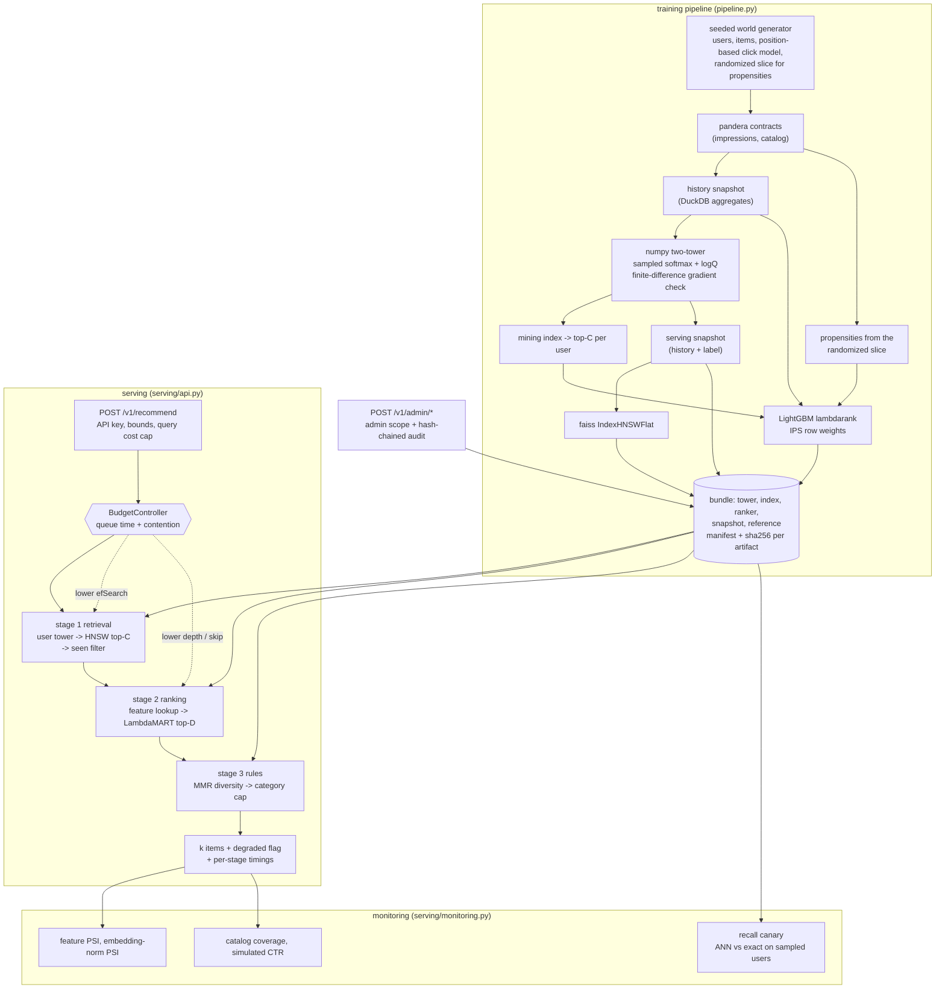

# retrieval-ranking-cascade

Two-tower candidate retrieval, HNSW approximate nearest-neighbour recall and LambdaMART reranking
served as one cascade under per-stage latency budgets, with position-bias-corrected evaluation and a
live recall canary. Everything runs offline on a CPU-only machine: the data is generated from seeds,
training takes seconds to a minute, and no API key or downloaded model is involved.

## Problem

Recommending 20 items out of 100k inside a 50 ms p99 budget cannot be done with one model. Scoring
the whole catalogue with a gradient-boosted ranker costs 100k feature rows per request; a model
cheap enough to score 100k rows is not precise enough to rank the top 20. So the work is split:
retrieval narrows the catalogue to a few hundred candidates for a fraction of a millisecond, and an
expensive model only sees those.

That split creates three problems the repo is really about.

1. **The cascade has a recall ceiling.** An item approximate search misses can never be
   recommended, and HNSW recall degrades silently — a bad rebuild, a wrong `efSearch` or partially
   overwritten vectors all still return plausible neighbours.
2. **The latency budget has to be enforced, not hoped for.** Under load the expensive stage is the
   one that blows the budget, and the only useful answer is a cheaper response rather than a late
   one.
3. **Offline click metrics are biased.** Clicks measure `P(examine | rank) * relevance`, so a naive
   CTR understates anything shown low on the page, and a ranker trained on raw clicks learns the
   logging policy's position bias instead of relevance.

## Architecture



**Stage 1, retrieval.** Two MLP towers (`retrieval/two_tower.py`) in numpy, with hand-derived
sampled-softmax gradients and logQ popularity correction (Yi et al., RecSys 2019). Every analytic
gradient is compared against a central finite difference over a range of shapes. Item embeddings go
into a faiss `IndexHNSWFlat` under inner product; `efSearch` is passed per query so concurrent
searches with different budgets stay thread-safe. The seen filter runs between stages 1 and 2, so
the expensive stage never scores an item that was going to be dropped.

**Stage 2, ranking.** LightGBM `lambdarank` (`ranking/ranker.py`) over user-history aggregates, item
statistics, tower similarity and recency. Features are precomputed into a hash-verified snapshot
loaded at startup; online feature stores are out of scope. The same `assemble_features` builds
training and serving rows, so they cannot drift apart. Each serving thread parses its own booster
from the shared model text: a single booster behind a mutex serializes the whole stage, measured at
4.9x less throughput under eight callers (`bench/bench_baseline.py::bench_ranker_predict_threads`).

**Stage 3, rules.** MMR diversity (Carbonell and Goldstein, SIGIR 1998) over a bounded window, then
a hard per-category cap applied as an order-preserving filter.

**Budgets and degradation** (`serving/budget.py`). Before each stage the controller predicts the
cost of the planned work from what past requests actually cost (`fixed + rate * units`, EWMA,
inflated by a safety factor), compares it with the time left, and walks a ladder: lower `efSearch`,
then lower the rerank depth, then skip reranking and return ANN order flagged `degraded`. Two inputs
make overload visible — the queue time a request already spent, and the number of accepted requests
in flight, which stands in for the backlog that cannot be measured from inside the process.

**Bundle registry** (`serving/bundle.py`). Tower, index, ranker, feature snapshot and drift
reference ship as one unit with a manifest recording the impression-log hash, every seed and
hyper-parameter, the lockfile hash and a SHA-256 per artifact. The manifest is read first, every
digest is checked, and only then is a parser allowed near the bytes. Nothing is pickled.

## Quickstart

Requirements: [uv](https://docs.astral.sh/uv/) and Python 3.12. No GPU, no network at run time.

```bash
uv sync --frozen
uv run python tasks.py demo    # trains, serves in-process, then breaks it on purpose
uv run python tasks.py check   # ruff, mypy --strict, pytest + coverage, bandit, pip-audit, baseline
uv run python tasks.py bench   # micro-benchmarks against bench/thresholds.json
```

On Windows, or on any machine where the repository drive is small, put the environment elsewhere
first: `$env:UV_PROJECT_ENVIRONMENT = "C:/Users/<you>/.venvs/retrieval-ranking-cascade"`.

Train a bundle and serve it:

```bash
uv run retrieval-ranking-cascade train --scale small --out var/bundle
uv run retrieval-ranking-cascade bundle var/bundle          # verify the manifest and every digest
uv run retrieval-ranking-cascade generate-api-key           # prints a key and its SHA-256 digest

APP_API_KEY_SHA256=<digest> APP_ADMIN_API_KEY_SHA256=<digest> APP_BUNDLE_DIR=var/bundle \
  uv run retrieval-ranking-cascade serve

curl -s http://127.0.0.1:8000/readyz
curl -s -H "X-API-Key: <key>" -H "Content-Type: application/json" \
     -d '{"user_id": 3, "k": 10}' http://127.0.0.1:8000/v1/recommend
curl -s -H "X-API-Key: <key>" http://127.0.0.1:8000/v1/monitoring
curl -s -X POST -H "X-API-Key: <admin key>" http://127.0.0.1:8000/v1/admin/canary
uv run retrieval-ranking-cascade audit verify var/audit/admin.jsonl
```

Scales: `tiny` (300 users, tests), `smoke` (500 users, the CI training smoke), `small` (5k users,
10k items, the demo and the benches), `full` (50k users, 100k items, the specification's world - the
CLI and the benches accept it, but no number in this README comes from it; see Non-goals).

The benches are separate because they take longer than `tasks.py bench`:

```bash
uv run python bench/bench_quality.py --check              # recall, NDCG, bias, shilling, canary
uv run python bench/bench_quality.py --check --ablations  # plus the five sweeps
uv run python bench/bench_load.py --check                 # p50/p99 at 50, 100 and 200 RPS
```

Containers: `docker compose run --rm train` writes a bundle into the `bundle` volume, then
`docker compose up app` serves it from the non-root, read-only image. Container build, smoke test,
hadolint, trivy scan and SBOM generation are verified in CI (`.github/workflows/ci.yml`, job
`docker`); they were not run locally as part of building this repo.

## Results

Every number below is copied from a real run on this machine: **Windows 10 (10.0.19045), Intel64
Family 6 Model 158 Stepping 10, 6 logical CPUs, CPU-only, Python 3.12.14**, on 2026-09-27. Each
table names the command that produced it. CI runs the same commands against the thresholds in
`bench/thresholds.json`.

### Cascade quality

`uv run python bench/bench_quality.py --check --ablations` — `small` scale (5k users, 10k items,
~200k impressions), one training run of 13.4 s feeding every block, **124.7 s** total; the same
command without `--ablations` is **70.4 s**. Both printed "all quality thresholds met", and every
number in this section comes from the run recorded in `bench/results/quality.json`.

Retrieval, recall@500 against exact search over 200 queries:

| efSearch | recall@500 | recall p05 | ANN ms/query |
|---:|---:|---:|---:|
| 64 | 0.6232 | 0.4997 | 0.126 |
| 128 | 0.8057 | 0.6457 | 0.204 |
| 256 | 0.9313 | 0.7659 | 0.364 |
| 512 | 0.9757 | 0.9340 | 0.616 |
| **768 (default)** | **0.9771** | **0.9360** | **1.099** |
| 1024 | 0.9774 | 0.9360 | 1.775 |

**Does the index earn its place?** Not at this catalogue size and this candidate count, and the bench
answers with numbers rather than a caveat. Exact brute force over the same 200 queries costs
0.136 ms/query, so at 10k items the graph walk is about **8x slower** than one dense 10k x 32 matmul.
Since the `small` world is the only world this repo trains, the scaling block measures the cost curve
on larger catalogues directly: rows past the trained 10k are real item embeddings resampled with
Gaussian noise and rescaled to the norm of the row they came from, which keeps the cluster structure
the graph walks over. Search cost and recall against exact search *on the same catalogue* are real
measurements of the index at that size; relevance on those rows would not be, and nothing uses them
for it.

| catalogue size | resampled rows | ANN ms/query | exact ms/query | ANN speedup | recall@500 |
|---:|---:|---:|---:|---:|---:|
| 2 500 | 0 | 1.015 | 0.073 | 0.07x | 0.9756 |
| 10 000 (as trained) | 0 | 1.137 | 0.135 | 0.12x | 0.9771 |
| 50 000 | 40 000 | 1.237 | 0.518 | 0.42x | 0.9980 |
| 100 000 | 90 000 | 1.362 | 0.866 | 0.64x | 0.9964 |

Fitted over those four points, exact costs 0.0082 ms per 1k items while the graph costs 1.06 ms fixed
plus 0.0032 ms per 1k, so **the two lines meet near 197k items** — past the specification's 100k
world. Two sizes could not measure that (across runs the two-point fit produced both signs of slope
for the exact baseline); four can.

What the index does pay for is a *small* request. `efSearch` has to be at least `k`, so the graph's
cost grows with how many neighbours are asked for while the matmul's does not. At 100k items:

| candidates | efSearch | ANN ms/query | exact ms/query | ANN speedup | recall |
|---:|---:|---:|---:|---:|---:|
| 10 | 64 | 0.055 | 0.850 | **15.5x** | 0.9940 |
| 50 | 128 | 0.109 | 0.899 | 8.3x | 0.9942 |
| 100 | 256 | 0.272 | 0.981 | 3.6x | 0.9973 |
| **500 (this cascade)** | **768** | **1.393** | **0.855** | **0.61x** | 0.9964 |

So: a 32-dimensional index over 100k items beats brute force by 15x when a request wants ten
neighbours, and loses to it when the request wants five hundred — and this cascade wants five hundred,
because stage 2 needs a candidate *set*, not a page. The index stays because it is what makes the
recall/latency knob (the ladder's first step) and the recall canary mean anything, and because it is
the structure a larger catalogue would need; it is not here because it is faster at the size measured.

Slate reranking, 1500 held-out sessions, k=10. Each policy reorders exactly the items the logging
policy showed, scored three ways — naively from clicks, with IPS weights, and against the world's
true relevance:

| policy | NDCG naive | NDCG IPS | NDCG truth | MRR naive | MRR truth |
|---|---:|---:|---:|---:|---:|
| logged (production policy) | 0.8257 | 0.7083 | 0.8629 | 0.8140 | 0.5308 |
| **cascade** | 0.6909 | 0.6176 | **0.8545** | 0.6245 | 0.5010 |
| tower only | 0.6643 | 0.5993 | 0.8324 | 0.5852 | 0.4548 |
| popularity | 0.6231 | 0.5530 | 0.7442 | 0.5211 | 0.3061 |

The cascade beats both baselines on ground truth (+0.022 over the tower, +0.110 over popularity).
It does not beat the logged policy, and should not be expected to: this world's logging policy
scores candidates with a noisy version of the true relevance logit, so it is a strong teacher rather
than a straw man. Note also that the naive column ranks the logged policy first by a wide margin
while ground truth puts it barely ahead — that gap is the position bias this repo measures.

Full-catalogue top-10, scored against true relevance. Every row is averaged over the same 150 sampled
users, the unservable `exact_rank` row included, and each row carries its own count — an earlier
version of this table computed that row over 40 users under a header that claimed 150 for all of them,
which made an unpaired comparison look like a paired one:

| policy | users | NDCG@10 | intra-list sim | coverage | cold-item share | cold-user NDCG (users) |
|---|---:|---:|---:|---:|---:|---:|
| popularity | 150 | 0.3224 | 0.5429 | 0.0015 | 0.0000 | 0.2733 (19) |
| tower only | 150 | 0.6205 | 0.6276 | 0.0488 | 0.0440 | 0.4584 (19) |
| cascade (MMR off) | 150 | 0.6100 | 0.5128 | 0.0228 | 0.0661 | 0.4125 (19) |
| cascade (as served) | 150 | 0.6059 | 0.5062 | 0.0226 | 0.0648 | 0.4115 (19) |
| exact full-corpus ranking | 150 | 0.6095 | 0.4828 | 0.0446 | 0.1513 | 0.3708 (19) |

**The candidate set costs nothing.** Scoring all 10k items with the same LambdaMART model gets 0.6095
against the cascade's 0.6100 over the same 150 users — a gap of -0.0004, i.e. the cascade retains
**1.0007** of the full-corpus ranking. Neither of its two approximations, a finite candidate set and an
approximate search inside it, costs measurable quality here. `exact_rank` is a reference and not a
ceiling: the same imperfect model scoring more items can land slightly *below* it on true relevance,
and here it does. It is also a raw top-k by model score, with no MMR and no category cap, which is why
its coverage and cold-item share are the highest in the table and its cold-user NDCG the lowest.

**The reranker still does not beat the tower on this protocol** (0.6100 against 0.6205). Because the
full-corpus ranking with the same model does not beat the tower either, the limit is the model rather
than the cascade around it: the ranker is trained on label-period slates the logging policy chose,
which is the only supervision click data can honestly provide, and that distribution does not cover
the full catalogue. It wins on the slate protocol, where it was trained, and comes 0.0105 short of the
tower on the corpus protocol. Reported rather than smoothed over; closing it needs candidate-aware
negative mining, which is a Non-goal below.

MMR and the category cap then cost 0.0041 NDCG and buy lower intra-list similarity (0.5062 against
0.5128) and a higher share of cold items.

Position bias, mean relevance per rank over non-randomized impressions:

| rank | naive CTR | IPS estimate | true relevance |
|---:|---:|---:|---:|
| 1 | 0.6008 | 0.6008 | 0.6023 |
| 2 | 0.2415 | 0.4897 | 0.4931 |
| 5 | 0.0748 | 0.3287 | 0.3772 |
| 10 | 0.0273 | 0.3154 | 0.2783 |

Mean absolute error against truth: **naive 0.2513, IPS 0.0373** — a 85.2% reduction. The examination
exponent recovered from the randomized slice alone is 1.024 against a true 1.0. On the harder
question — the *relative* lift of a policy over the logged one — IPS cuts the bias from 0.1406 to
0.1063 (24.4%), a much smaller win, because a ratio of two noisy NDCGs is a harder estimand than a
level.

Shilling robustness. 200 fresh accounts each click a mid-popularity target item plus popular filler:

| accounts | sessions each | item statistics | rank before | rank after | lift | damping |
|---:|---:|---|---:|---:|---:|---:|
| 50 | 1 | robust | 5263.75 | 2720.42 | 1.94x | 25.4x |
| 50 | 1 | naive | 3818.42 | 77.75 | 49.11x | |
| 200 | 1 | robust | 5263.75 | 1827.75 | 2.88x | 27.5x |
| 200 | 1 | naive | 3818.42 | 48.25 | 79.14x | |
| 200 | 4 | robust | 5263.75 | 46.00 | 114.43x | 0.58x |
| 200 | 4 | naive | 3818.42 | 57.83 | 66.02x | |

Against one-session accounts the robust aggregation keeps the target out of the visible ranks while
the naive one puts it in the top 80 of 10000. **Against accounts with four sessions each the defence
fails** — tenure weighting saturates at the trust threshold, so an attacker who is willing to build
a little history defeats it. That is a limitation of this control, not a gap in the measurement; see
Non-goals and `docs/THREAT_MODEL.md`.

Recall canary: healthy recall 0.9833 (no alert); after 5000 of 10000 index vectors are overwritten
with random unit vectors, 0.3642 and an alert **within one cycle** of 0.087 s.

Ablations:

| knob | setting | effect |
|---|---|---|
| logQ correction | on / off | recall 0.9748 / 0.9827, corpus NDCG 0.6100 / 0.5886 — trades a little recall for ranking quality |
| ranker labels | naive clicks / IPS weights / LightGBM unbiased | corpus NDCG 0.5690 / **0.6100** / 0.4834; slate NDCG truth 0.8237 / 0.8544 / 0.8722 |
| MMR lambda | 1.0 / 0.7 / 0.4 | intra-list sim 0.5128 / 0.5062 / 0.4871; true relevance 0.5835 / 0.5808 / 0.5666 |
| rerank depth | 50 / **100 (default)** / 150 / 250 / 500 | NDCG 0.6074 / **0.6100** / 0.6054 / 0.6055 / 0.5981 at 2.97 / 3.96 / 4.65 / 6.30 / 9.38 ms per request |
| efSearch | 128 / 256 / 768 | NDCG 0.6100 / 0.6100 / 0.6100 |

Three of these are worth naming. LightGBM's unbiased lambdarank wins the slate metric by a wide margin
and loses the corpus metric by an even wider one, which is why IPS weighting is the default and the
unbiased variant is kept only as an ablation.

The depth curve peaks at 100 while cost stays linear in depth, so **the served default is rerank depth
100**, not the 150 this repo first shipped: at this scale 100 is both better (0.6100 against 0.6054)
and cheaper (3.96 ms against 4.65 ms), and 500 is worse for 2.4x the cost. The ablation row is the
whole justification for the deviation, and the main tables above are measured at the new default.

And efSearch does not move NDCG@10 between 128 and 768 at all, even though recall@500 moves from
0.8057 to 0.9771: at depth 100 the reranker only ever sees the top of the candidate set, and a
narrower search still finds that part of it. The recall a wide search buys is insurance for the users
whose good items sit deeper, not average-case quality — which is why efSearch is the ladder's
first and cheapest thing to give up.

### Served latency

`uv run python tasks.py load` (`bench/bench_load.py --check`) — the repo's own `serve` entry
point in a separate process, one uvicorn worker, one faiss thread, three client processes issuing
requests at a fixed schedule (not closed-loop, so a slow response queues behind rather than delaying
the next send). `small` bundle, candidate_k=500, efSearch=768, rerank depth 100, k=20, 50 ms budget.
Printed "load thresholds met"; the run is recorded in `bench/results/load.json`.

| phase | target RPS | achieved | p50 ms | p95 ms | p99 ms | server p50 ms | errors | degraded | peak in-flight |
|---|---:|---:|---:|---:|---:|---:|---:|---:|---:|
| nominal | 50 | 50.1 | 12.74 | 16.67 | **20.51** | 4.23 | 0 | 0.0% | 3 |
| overload 2x | 100 | 100.0 | 16.99 | 26.26 | 36.09 | 5.23 | 0 | 0.0% | 6 |
| saturate 4x | 200 | 200.0 | 28.59 | 88.42 | 124.72 | 8.70 | 0 | 0.1% | 18 |

p99 at 50 RPS is **20.5 ms against a 50 ms SLO**, with zero errors. Across three clean runs on this
machine in one sitting the nominal p99 was 18.1, 20.5 and 26.8 ms; earlier runs taken while the machine
was also running the test suite measured 39.7 and 48.7 ms, which is the shape of a shared box rather
than of the code.

The `server p50 ms` column is the server's own view of the same requests — the queue wait it measured
plus the time its stages took. At the nominal rate that is 4.2 ms against a client-observed 12.7 ms,
so most of what a client sees at low load is connection handling and the client's own event loop, not
the cascade.

That gap is also what makes the 4x phase hard to interpret, and the bench says so out loud. At 200 RPS
three client processes are close to their own ceiling on six cores. In the run above the phase held
200.0 RPS with a client p50 of 28.6 ms against a server-side 8.7 ms; in two other runs on the same box
the clients collapsed instead, achieving 142.7 and 103.6 of 200 RPS with client p50s of 35 ms and
7 073 ms against server-side p50s of 7.5 ms and 3.6 ms — requests waiting inside httpx for a free
connection while the server never saw the offered concurrency. The bench flags such a phase as
`harness-limited` and does **not** assert the shed-quality invariant for it, because the budget
controller correctly saw nothing late to shed. It compares the client's view with the server's at both
the median *and* the 99th percentile, because a connection pool saturates at the tail first: the
142.7 RPS run sat at 4.7x on the median, just under the 5x flag, while its p99 was 9 302 ms against a
server-side tail in the tens of milliseconds. That is a limit of the load generator, and it is
reported rather than hidden.

The invariant CI does enforce is the one the design rests on, wherever the server is what fell behind:
**whenever throughput falls behind the offered rate, at least 10% of responses must be degraded**
(`min_degraded_rate_when_behind` in `bench/thresholds.json`).
Errors must be zero in every phase, and throughput must hold at the nominal rate. The ladder itself is
tested directly rather than only through load: `tests/unit/test_budget.py` and
`tests/unit/test_cascade.py` drive each of its three steps with starved budgets and with contention,
and `tests/integration/test_cascade_api.py::test_a_degraded_response_is_labelled_and_counted` checks
the flag and the counter over HTTP.

### Component costs

`uv run python tasks.py bench` (which runs `bench/bench_baseline.py --check`). Microseconds per
call; single-machine numbers for spotting regressions, not performance claims. Printed
"all micro-benchmarks within thresholds".

| benchmark | runs | p50 (us) | p95 (us) | calls/s |
|---|---:|---:|---:|---:|
| redact_text_1kb | 2000 | 351.3 | 603.2 | - |
| rate_limiter_check | 20000 | 1.9 | 2.1 | - |
| drift_check_10k_vs_10k | 30 | 2282.9 | 3426.9 | - |
| ann_search_top500_50k_items | 200 | 1972.0 | 2919.5 | - |
| assemble_features_500_rows | 500 | 65.5 | 95.6 | - |
| mmr_select_200_candidates | 200 | 802.8 | 1442.5 | - |
| filter_seen_500_candidates | 2000 | 138.2 | 194.7 | - |
| budget_plan_request | 5000 | 6.0 | 6.9 | - |
| ranker_predict_100_rows_1_thread | 60 | 1936.2 | 2517.7 | 492.2 |
| ranker_predict_100_rows_8_threads_thread_local | 480 | 1988.1 | 4668.6 | 2363.1 |
| ranker_predict_100_rows_8_threads_shared_mutex | 480 | 1987.4 | 55328.7 | 481.1 |
| audit_append_fsync | 100 | 8566.4 | 11320.3 | - |
| audit_verify_500_entries | 10 | 10587.0 | 11328.9 | - |
| estimate_propensities_200k_rows | 20 | 524.3 | 869.4 | - |

Four of these are worth a sentence. `audit_append_fsync` includes one `fsync` per entry, so it mostly
measures the disk. `budget_plan_request` is the whole plan-a-request path at 6.0 us — about 0.01% of
the 50 ms budget it protects, which is the argument for predicting rather than hoping.

The three `ranker_predict` rows are why each serving thread parses its own booster. One caller alone
sustains 492 predictions per second over 100 feature rows; eight callers with a booster each sustain
2 363 (4.8x, on six cores); eight callers sharing one booster behind a `threading.Lock` sustain 481 —
**the lock caps the whole pool at a single caller's throughput**, and its p95 is 55.3 ms against
4.7 ms. The per-call median is nearly identical in all three (about 1.99 ms), which is why throughput
is measured here at all: serialization does not show up in the median caller's latency. Only the
single-caller row is gated by a threshold, because what a shared CI runner reports for contention
depends on how many cores it has and who else is on them.

And `mmr_select_200_candidates` used to be the worst tail in the repo: a p50 of 2.1 ms with a p95 that
reached 29 ms, because the greedy loop re-sliced the selected columns of the similarity matrix on
every pick — O(k^2 n) work and a fresh allocation each iteration. Carrying the similarity maximum
forward with `np.maximum` instead makes it O(k n) with no per-iteration allocation, and took p50 to
0.73 ms (0.80 ms in the run above). The p95 still moves between 1.1 and 2.9 ms across runs on this
box; that is the machine, and the threshold is set several times above it.

### Tests

`uv run python tasks.py test`: **750 tests, 98% line and branch coverage** (98.07%, floor 85%), whole
suite in 71 s with the `ci` hypothesis profile. No test touches the network — an autouse fixture blocks
every non-loopback socket, and nothing downloads a model or a dataset.

## Security

Threats, controls and the tests that prove them are in
[docs/THREAT_MODEL.md](docs/THREAT_MODEL.md); every claim here maps to a test, bench or CI job in
[CLAIMS.md](CLAIMS.md).

- **Authentication and scopes.** API keys are stored as SHA-256 digests, compared in constant time.
  `/v1/admin/*` (reindex, bundle swap, canary) additionally requires the key to be listed as an
  admin key, and every privileged action — including a *refused* bundle swap — is appended to a
  hash-chained audit log before the response returns.
- **Input bounds and a query cost cap.** `user_id`, `k`, `candidate_k`, `ef_search` and the
  diversity lambda are all bounded, and a cost cap
  (`candidate_k * sqrt(max(ef_search, candidate_k))`) rejects combinations that are individually
  legal but expensive together, so an authenticated caller cannot turn one request into a hundred
  requests' worth of ANN work.
- **Artifact integrity, no pickle.** Every bundle artifact's SHA-256 is checked against the manifest
  before any parser sees the bytes — faiss' index reader and LightGBM's model reader are C++
  parsers. `.npz` is loaded with `allow_pickle=False`; the LightGBM model is text. `bundle_id` is
  the hash of the manifest itself, so a tampered manifest fails its own id check. A test flips one
  byte in each of the five artifacts in turn and expects five refusals.
- **Data contracts.** The impression log and the catalog are validated with pandera before training;
  the feature snapshot re-validates its own shapes and ranges on every load; ingested feedback is
  validated against a contract derived from the live bundle's dimensions.
- **Feedback-poisoning defences.** Item statistics count each user at most once per item, weight
  each user by tenure and shrink item CTR towards the global rate. A shilling test injects fake
  accounts and asserts the target item's rank stays above a threshold, with the naive aggregation
  measured alongside it as the control. Feedback ingestion is rate limited per source, so one client
  cannot flood the statistics. Accepted feedback never feeds training.
- **Reproducibility.** Seeds, the impression-log hash, every hyper-parameter, the lockfile hash and
  package versions go into the run manifest. A test trains twice and asserts byte-identical
  artifacts and an identical metric hash — which is how the non-determinism in the DuckDB
  aggregation was found and fixed.
- **Drift and recall monitoring.** Feature PSI and embedding-norm PSI against the bundle's stored
  training reference, catalog coverage, simulated CTR and a recall canary comparing the live index
  with exact search on sampled real user vectors.
- **Privacy.** The data is synthetic and PII-free. User ids are replaced by keyed, truncated digests
  before they reach logs or audit records; the key is per process, so digests cannot be reversed by
  enumerating a small id space.
- **Errors and transport.** Fixed error codes and messages; no exception text, traceback or
  submitted value in a response. Token-bucket rate limiting, body-size limits, security headers and
  CORS restricted to explicit origins.
- **CI.** ruff, mypy `--strict`, pytest with an 85% coverage floor, bandit, semgrep with repo rules,
  pip-audit, gitleaks, a training smoke with metric thresholds, the quality and load benches against
  their thresholds, hadolint, a container build and smoke test, a trivy image scan and a syft
  CycloneDX SBOM. Base images are pinned by digest. See [SECURITY.md](SECURITY.md) for reporting.

## Non-goals

- **Beating a production recommender.** The world is synthetic, and its logging policy sees a noisy
  version of the truth. The point is the measurement apparatus and the cascade's engineering, not
  the absolute NDCG.
- **A ranker that beats the tower on the full corpus.** Measured above; it does not at this scale, and
  the exact full-corpus ranking with the same model does not either, so the limit is the model's
  training distribution rather than the cascade. Closing it would mean mining negatives from the
  *serving* candidate distribution — sampling the ANN candidates each user would actually be shown
  and labelling them from the click log's implicit feedback — rather than the 20 extra negatives per
  session this repo draws. That is a training-data change with its own bias questions, and it is out
  of scope here; the ablation that would decide it is not run.
- **Numbers at the specification's 50k x 100k world.** Every measured number here is the `small`
  world (5k users, 10k items). `--scale full` is accepted by the CLI and by the benches, but it was
  never run on the machine this repo was built on (six cores, about 2 GB free), so nothing in this
  README is quoted from it and its runtime and memory are unknown. What the 100k-item measurements
  above do cover is retrieval cost and recall, on a resampled catalogue of that size.
- **Shilling resistance against aged accounts.** Tenure weighting saturates at the trust threshold,
  so 200 accounts with four sessions each defeat it (measured above). Rate limiting, account-age
  gates and graph-based detection are out of scope.
- **An online feature store.** Features come from a snapshot loaded at startup. A request never
  reads a database, so a user's behaviour inside the current session does not affect their features.
- **Sharding or replication.** One process, one index in memory, one bundle. Rate-limit buckets,
  cost estimators and the in-flight counter are per process; several replicas would each budget
  independently.
- **Interrupting a running stage.** The budget controller bounds *planned* work. A stage that has
  started is never cancelled, so a single pathological call can still overshoot the budget.
- **A tamper-proof audit log.** The chain is tamper-*evident*: any edit, deletion or reordering
  breaks it and the break is localized. Detecting truncation of the tail after the fact needs the
  head hash stored somewhere else.
- **Real-time or incremental index updates.** `/v1/admin/reindex` rebuilds the whole index from the
  live item vectors. There is no incremental add, delete or ttl.
- **A model server or MLflow tracking server.** The registry is a local content-addressed store;
  `mlflow-skinny` is used for the file backend only, with no server and no remote artifact store.
- **Exact propensity recovery.** Propensities are identified only up to the scale of rank 1, ranks
  with too little randomized traffic inherit the nearest reliable rank, and weights are clipped,
  which trades a little bias for a large variance reduction.
- **Neural ranking or GPU training.** The two-tower model is a small numpy MLP by choice (see
  [ADR 0002](docs/adr/0002-numpy-two-tower.md)); no torch, no transformers, no downloaded weights.

## License

MIT — see [LICENSE](LICENSE).
